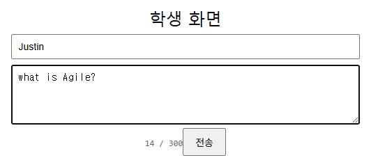
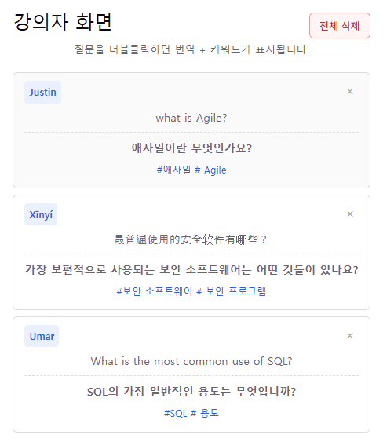
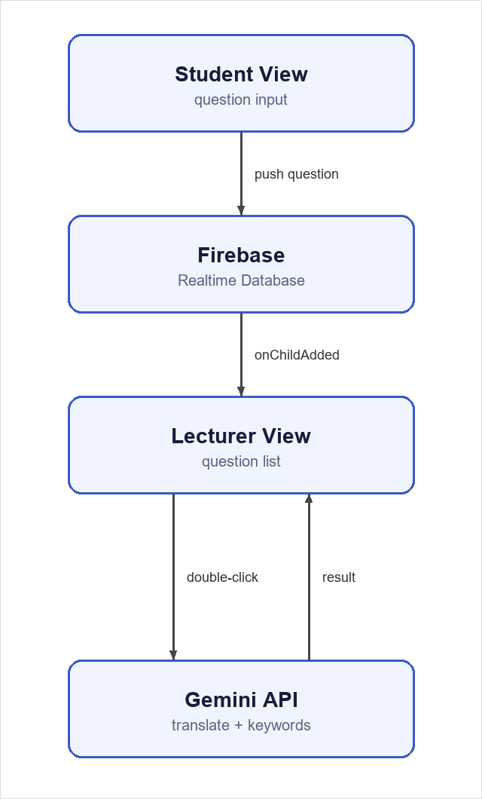

# translation-qa

강의 중에 유학생이 모국어로 질문을 보내면, 강의자 화면에 한국어 번역과 핵심 키워드가 함께 뜨는 웹 앱입니다.

한국어 수업에서 유학생은 질문을 한국어로 만들어야 한다는 부담 때문에 질문을 포기하는 경우가 많습니다. 학생은 자기 언어로 편하게 쓰고, 강의자는 번역문과 키워드만 보고 바로 답할 수 있게 하는 게 목표였습니다. 설치 없이 웹 주소만으로 쓸 수 있어야 해서 별도 서버 없이 만들었습니다.

- 배포: https://translation-qa-chi.vercel.app (학생 화면), `/lecturer` (강의자 화면)
- 논문: 최건우, 임세정, 「실시간 번역 및 키워드 추출 기반 다국어 강의 질의응답 시스템」, 2026년 제39회 한국전자통신학회 가을철학술대회 구두 발표

## 화면

| 학생 화면 | 강의자 화면 |
| --- | --- |
|  |  |

학생이 질문을 보내면 강의자 화면 목록에 바로 추가되고, 강의자가 질문을 더블클릭하면 원문 아래에 번역문과 `#키워드`가 표시됩니다.

## 구조



- 학생 화면에서 보낸 질문은 Firebase Realtime Database에 저장됩니다. 저장 항목은 질문, 이름, 시각(서버 시각), 세션 ID입니다.
- 강의자 화면은 `onChildAdded`로 새 질문을 구독하기 때문에 따로 API 서버를 두지 않았습니다.
- 강의자가 질문을 더블클릭하면 Gemini API(`gemini-3.5-flash-lite`)를 한 번 호출해서 번역문과 키워드 1~2개를 JSON으로 받습니다.
- 배포는 Vercel 정적 호스팅입니다. `main`에 푸시하면 자동으로 배포됩니다.

<br clear="right">

**기술 스택**: React 19, Vite, Firebase Realtime Database, Gemini API, Vercel

## 주요 기능

- 학생 화면(`/`)과 강의자 화면(`/lecturer`)을 경로로 분리해서, 학생은 다른 학생의 질문을 볼 수 없습니다.
- 이름은 선택 입력입니다. 비워 두면 "익명"으로 표시됩니다.
- 질문을 보낸 뒤 10초 동안은 다시 보낼 수 없습니다. 마지막 전송 시각을 `localStorage`에 저장하기 때문에 새로고침해도 유지됩니다.
- 강의자는 질문을 하나씩 지우거나, 확인 창을 거쳐 전부 지울 수 있습니다.
- 질문은 최대 300자, 이름은 최대 30자입니다. 강의자 화면에는 최근 50개가 표시됩니다.

## 개발하면서 정한 것들

**온디바이스 AI 대신 Gemini API**

처음에는 Chrome에 내장된 Gemini Nano(Translator API, Prompt API)를 쓰려고 했습니다. API 비용이 없고 질문이 외부로 나가지 않는다는 점이 좋았습니다. 그런데 테스트 PC(Windows 11, Chrome 152)에서 모델 다운로드가 `pending` 상태에서 넘어가지 않았습니다. 네트워크, 방화벽, 프록시, 브라우저 프로필을 바꿔 봐도 해결되지 않았습니다. 학생마다 기기가 다른 강의실에서는 이런 실행 환경을 미리 보장하기 어렵다고 판단해서 클라우드 API로 바꿨습니다.

Google Cloud Translation API는 결제 계정 등록이 필요해서, 무료 등급이 있는 Gemini API를 선택했습니다.

**번역과 키워드를 한 번에**

번역과 키워드 추출을 따로 호출하지 않고 프롬프트 하나로 처리합니다. 응답 형식을 JSON(`{"translated": ..., "keywords": ...}`)으로 지정해서 파싱 오류를 줄였습니다. TextRank 같은 키워드 추출 방식은 언어마다 형태소 분석이 필요한데, LLM을 쓰면 어떤 언어로 질문이 들어와도 그대로 처리할 수 있습니다.

**자동 번역 대신 더블클릭**

질문이 들어올 때마다 번역하면 질문 수만큼 API를 호출하게 됩니다. 무료 등급은 호출 횟수에 제한이 있어서, 강의자가 확인하려는 질문만 번역하도록 했습니다.

## 한계와 다음 단계

- 화면 분리는 UI 수준입니다. 강의자 주소를 알면 누구나 들어갈 수 있고, 데이터베이스도 로그인 없이 읽고 쓸 수 있습니다.
- Gemini API 키가 클라이언트 번들에 포함됩니다. 키를 서버리스 함수 뒤로 옮길 계획입니다.
- 쿨타임은 클라이언트에서만 검사하기 때문에 우회할 수 있습니다.
- 지금은 모든 질문이 한 목록에 쌓입니다. 수업별로 분리하는 작업은 `room-codes` 브랜치에서 진행 중입니다.
- 번역 품질과 응답 시간은 아직 정량적으로 측정하지 않았습니다.

다음 단계는 Firebase 인증과 보안 규칙 적용(학생은 쓰기만, 강의자는 읽기·삭제만), API 키 보호, 실제 강의 시범운영입니다.

## 로컬에서 실행하기

1. Firebase 콘솔에서 프로젝트를 만들고 Realtime Database를 생성합니다.
   - 웹 앱 설정값을 `src/services/firebaseConfig.js`에 넣습니다.
   - Realtime Database 규칙 탭에 `firebase.rules.json` 내용을 붙여넣고 게시합니다.
2. https://aistudio.google.com/apikey 에서 Gemini API 키를 발급받습니다.
   - 루트에 `.env` 파일을 만들고 `VITE_GEMINI_API_KEY=발급받은키`를 넣습니다. `.env`는 커밋되지 않습니다.
3. 실행합니다.
   ```
   npm install
   npm run dev
   ```
   `.env`를 바꾼 뒤에는 개발 서버를 다시 켜야 반영됩니다.

Vercel에 배포할 때는 프로젝트 설정의 Environment Variables에 `VITE_GEMINI_API_KEY`를 추가하고 다시 배포합니다.

## 폴더 구조

```
src/
  services/
    firebaseConfig.js      Firebase 연결 정보
    questionRepository.js  질문 저장·구독·삭제
    translator.js          Gemini API 호출 (번역 + 키워드)
  StudentView.jsx          학생 화면
  LecturerView.jsx         강의자 화면
  App.jsx                  경로에 따라 학생/강의자 화면 선택
```
